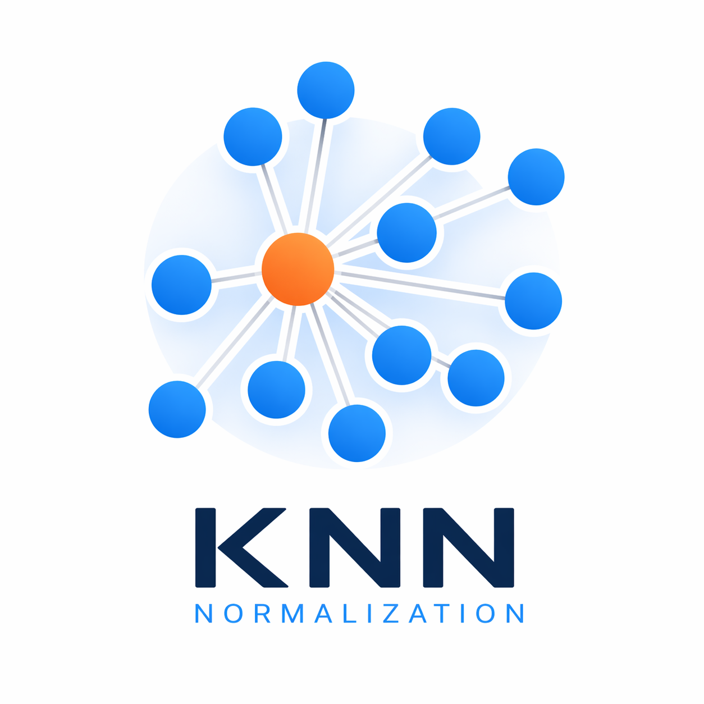

# KNN normalization

[![Tests][badge-tests]][tests]
[![Documentation][badge-docs]][documentation]

[badge-tests]: https://img.shields.io/github/actions/workflow/status/javier-marchena-hurtado/KNN_normalization/test.yaml?branch=main
[badge-docs]: https://img.shields.io/readthedocs/knn-normalization



## Background and motivation

KNN normalization is a normalization method for protein counts in CITE-seq data. KNN normalization learns from neighbor cells in a KNN graph in order to estimate the appropriate total protein counts in each cell, accurately estimating total protein counts while preserving biological information.

This is the **Python package** (based on [scanpy](https://scanpy.readthedocs.io)). If you work in R with [Seurat](https://satijalab.org/seurat/), use the **R package** [KNN.normalization](https://github.com/javier-marchena-hurtado/KNN_normalization_R) instead. For the same KNN graph, both packages give the same result.

## Installation

Install the latest release of `KNN_normalization` from [PyPI][]:

```bash
pip install KNN_normalization
```

## Basic usage

```python
import mudata as md
from knn_normalization import knn_normalize

# Load your CITE-seq MuData with a "prot" and an "rna" modality.
mdata = md.read_h5mu("path/to/your/mudata.h5mu")

# Run KNN normalization (modifies adata in place)
knn_normalize(mdata, calculate_neighbors_from="rna")
```
For a full walkthrough (neighbors from RNA or protein, downstream analysis, your own KNN graph), see the [tutorial][].

## Documentation

Please refer to the [documentation][],
in particular, the [documentation of the knn_normalize() function][].

## Installing the Development Version (optional)

If you need the latest unreleased features or bug fixes:

```bash
pip install git+https://github.com/javier-marchena-hurtado/KNN_normalization.git@main
```

## Release notes

See the [changelog][].

## Contact

Contributions, questions and issues are very welcome! For questions, help requests and contributions, please open a [discussion][] on GitHub or send an [email][].
If you found a bug, please use the [issue tracker][].

## Citation

> t.b.a

[issue tracker]: https://github.com/javier-marchena-hurtado/KNN_normalization/issues
[tests]: https://github.com/javier-marchena-hurtado/KNN_normalization/actions/workflows/test.yaml
[documentation]: https://knn-normalization.readthedocs.io
[tutorial]: https://knn-normalization.readthedocs.io/en/latest/notebooks/tutorial.html
[changelog]: https://knn-normalization.readthedocs.io/en/latest/changelog.html
[documentation of the knn_normalize() function]: https://knn-normalization.readthedocs.io/en/latest/generated/knn_normalization.knn_normalize.html#knn_normalization.knn_normalize
[pypi]: https://pypi.org/project/KNN_normalization
[discussion]: https://github.com/javier-marchena-hurtado/KNN_normalization/discussions
[email]: mailto:javier.marchena.hurtado@gmail.com
